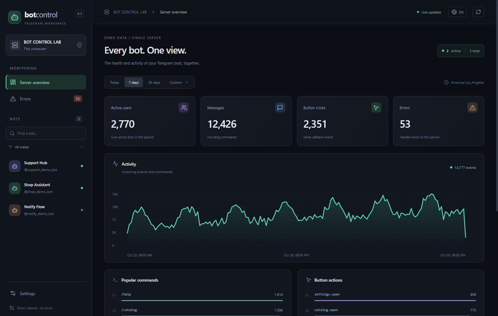

# Telegram Bot Control

[Русский](README.md) · [English](README.en.md)

Monitor and control existing aiogram bots: one owner, one Windows/Linux server, many bots.

## Install on Windows

**Use Python 3.11+ and the ready-made application. Node.js, pnpm and Git are not required.**
If your bot runs with `python main.py`, use that same Python:

1. Open PowerShell and install the SDK:

   ```powershell
   python -m pip install --upgrade telegram-bot-control
   ```

2. [Download the Windows installer](https://github.com/olegoleg1111121/telegram-bot-control/releases/download/v0.6.1/Telegram-Bot-Control-0.6.1-win-x64.exe) and run it.
3. Open **Telegram Bot Control** from its desktop/Start menu shortcut.
   Choose **Local**, enter `python` in the Python field and click **Connect**.

If Python is missing, [install Python for Windows](https://www.python.org/downloads/windows/)
and reopen PowerShell. Check `python --version`. If your bot runs with `py main.py`,
install with `py -m pip install --upgrade telegram-bot-control`.

[All downloads: Windows portable and Linux AppImage](https://github.com/olegoleg1111121/telegram-bot-control/releases/tag/v0.6.1).

## Quick browser mode

No separate desktop application is needed:

```sh
python -m pip install --upgrade telegram-bot-control
python -m telegram_bot_control web --port 8765
```

On Linux, use `python3` in both commands. Open **http://127.0.0.1:8765** and enter
its separate access key from the terminal. Keep the terminal open; Ctrl+C stops the dashboard.
[Web/Termux and network access](docs/web-panel.ru.md).

## Connect an existing bot

After your existing Bot/Dispatcher are created and before polling:

```python
from telegram_bot_control import start

monitor = start(bot=bot, dispatcher=dp, capture_logs=True)
dp.update.outer_middleware(monitor.middleware())
```

Keep your existing routers, logging, .env loader and launch command. Start the bot
normally once; it appears automatically. The dashboard also has a **Connect a bot** wizard.
By default, the bot and dashboard use the current owner's shared data directory.
If you set `data_dir`, use the same path in both.

**Working with AI?** [Copy the integration task](docs/ai-integration.en.md), also available
under **Connect with AI** in the dashboard.

## Features

- Bot status, users, messages, commands and callbacks.
- Custom events and sync/async function decorators, timelines, exact timestamps and outcomes.
- Existing logging/Loguru adapters, searchable logs and detailed startup errors.
- Per-process CPU, RSS and thread history.
- Explicit launch profiles, preparation steps, start/stop/restart and bounded automatic retries.
- Russian/English UI, first-run guide, tray and configurable retention.



## Try without a real bot

First terminal:

```sh
python -m pip install "telegram-bot-control[aiogram]"
python -m telegram_bot_control demo --bots 3
```

Second terminal:

```sh
python -m telegram_bot_control web --port 8765
```

Use `python3` on Linux. Open the displayed URL and enter the dashboard key.
The demo uses synthetic events; no Telegram token is required.

[Action analytics](docs/actions.en.md) · [AI integration](docs/ai-integration.en.md)
· [Process profiles](docs/process-control.md) · [Transport](docs/transport.md) · [Changelog](CHANGELOG.md).

**Changing the source code?** Follow the separate [developer setup](docs/development.en.md),
including Node.js and pnpm download/install instructions.

Early preview for one trusted owner. History begins at SDK connection. Bots sharing
one process share resources and cannot stop independently. Desktop Python is installed
separately. The Windows installer is currently unsigned.

Created by [Дмитрий Варг](https://github.com/olegoleg1111121). [MIT](LICENSE).
