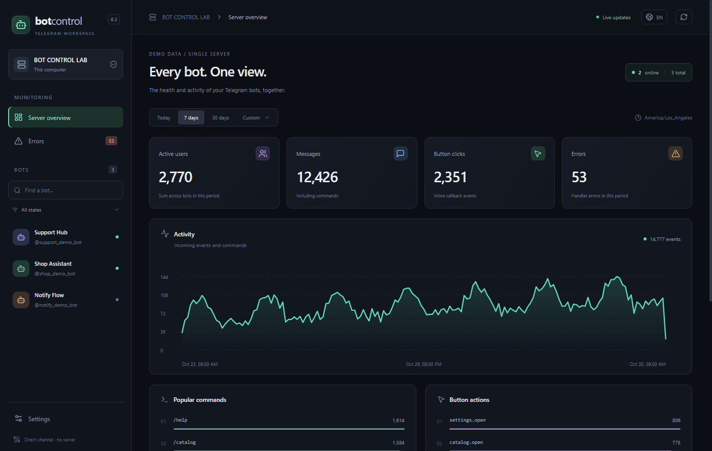

# Telegram Bot Control

[Русский](README.md) · [English](README.en.md)

Панель состояния, статистики, логов и управления вашими aiogram-ботами.
Один владелец, один Windows/Linux-сервер, сколько угодно подключённых ботов.

## Установка и запуск

Нужен Python 3.11 или новее. Установите пакет и откройте панель:

```sh
python -m pip install --upgrade telegram-bot-control
tgbots
```

Панель сама откроется в браузере. Python и папка статистики выбираются автоматически;
при локальном запуске вход тоже выполняется автоматически. Оставьте терминал открытым.
Для остановки панели нажмите `Ctrl+C` — боты продолжат работать.

Если команда `tgbots` не найдена, выполните **`python -m telegram_bot_control`**.
На Linux используйте `python3` вместо `python`; на Windows можно использовать `py`.
Node.js, pnpm и отдельный установщик для этого способа не нужны.

[Подключить первого бота](docs/getting-started.ru.md) · [Готовый промпт для ИИ](docs/ai-integration.ru.md).

<details>
<summary>Нужно отдельное окно приложения Windows?</summary>

[Скачайте desktop-установщик](https://github.com/olegoleg1111121/telegram-bot-control/releases/download/v0.8.0/Telegram-Bot-Control-0.8.0-win-x64.exe)
и откройте ярлык. Приложение само ищет Python в установленных версиях Windows,
стандартных папках и PATH. В списке видно, установлена ли библиотека. Если её нет,
появится окно с командой установки для выбранного Python.
Папку статистики обычно можно оставить пустой. Если перепутаны поля Python и папки,
приложение предложит исправить их. Для открытия установленной версии из терминала:
` tgbots desktop `.

**Обновления:** установленная Windows-версия и Linux AppImage проверяют GitHub при
запуске и каждые 6 часов, загружают новую сборку в фоне и предлагают
**Установить и перезапустить**. Настройки → Обновления приложения позволяют отключить
загрузку и выбрать предварительные версии. Боты продолжают работать. Для версий
0.7.0 и старше установите новый .exe один раз; ZIP-сборки обновляются вручную.
[Подробнее об обновлениях](docs/updates.md).

</details>

## Как добавить своего бота

После создания существующих `bot` и `dp`, перед запуском polling, добавьте:

```python
from telegram_bot_control import start

monitor = start(bot=bot, dispatcher=dp, capture_logs=True)
dp.update.outer_middleware(monitor.middleware())
```

Сохраните файл и запустите бота **своей обычной командой**. После его запуска
карточка появится в панели автоматически. Существующие `.env`, логгер и роутеры остаются.
В панели также есть кнопка **Подключить бота** с мастером настройки.

По умолчанию бот и панель используют общую папку данных текущего пользователя.
Если задаёте `data_dir` вручную, укажите одинаковый путь в коде бота и в панели.
Для webhook и сложной структуры проекта есть [подробная инструкция](docs/getting-started.ru.md).

**Работаете с ИИ?** [Скопируйте готовый промпт для подключения](docs/ai-integration.ru.md)
или откройте **Подключить с ИИ** в панели.

## Возможности

- Состояние ботов, пользователи, сообщения, команды и нажатия кнопок.
- Свои события и функции: `monitor.track_action()` и `@monitor.action()`,
  графики и история с точным временем, результатом и длительностью.
- Существующие logging/Loguru, поиск по логам и подробности ошибок запуска.
- CPU, память RSS и потоки процесса каждого бота.
- Запуск, остановка, перезапуск, подготовительные команды и ограниченный автоперезапуск.
- Русский/английский интерфейс, обучение при первом запуске, трей и настройка истории.



## Попробовать без своего бота

В первом терминале:

```sh
python -m pip install "telegram-bot-control[aiogram]"
python -m telegram_bot_control demo --bots 3
```

Во втором терминале:

```sh
tgbots
```

Откройте показанный адрес и введите ключ панели. Это синтетические события;
Telegram-токен не нужен. На Linux в командах замените `python` на `python3`.

## Документация

[Первый запуск](docs/getting-started.ru.md) · [Готовый промпт для ИИ](docs/ai-integration.ru.md)
· [События и графики](docs/actions.ru.md) · [Логи и ресурсы](docs/diagnostics.ru.md)
· [Профили запуска](docs/process-control.md) · [Веб/Termux](docs/web-panel.ru.md)
· [Схема связи](docs/transport.md) · [Изменения версий](CHANGELOG.md).

**Хотите менять исходники?** [Отдельная инструкция для разработчика](docs/development.ru.md)
объясняет, где скачать Node.js и как установить pnpm. Для использования готовой программы
эту инструкцию выполнять не требуется.

Ранняя версия для одного доверенного владельца. История начинается после подключения SDK.
Боты в одном Python-процессе делят его ресурсы и не могут останавливаться независимо.
Python устанавливается отдельно от desktop-приложения. Подпись установщика пока не настроена.

Автор: [Дмитрий Варг](https://github.com/olegoleg1111121). [Лицензия MIT](LICENSE).
