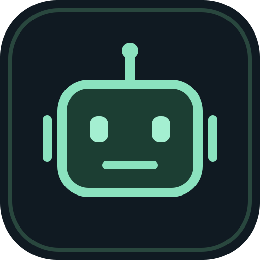
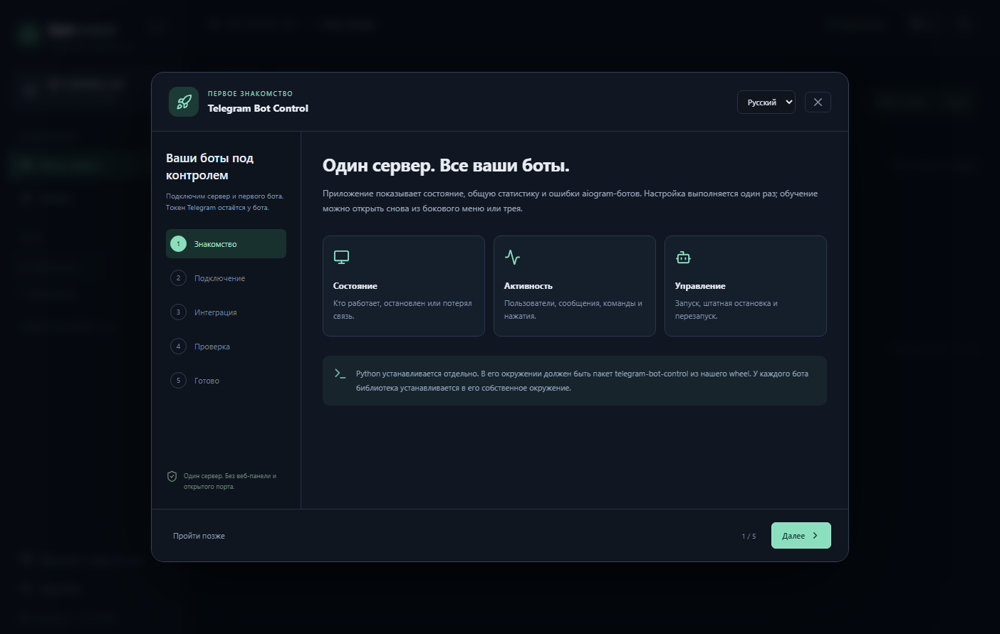
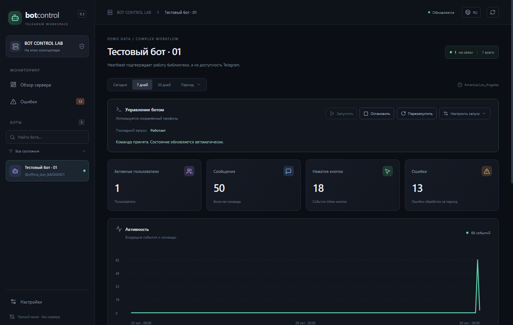
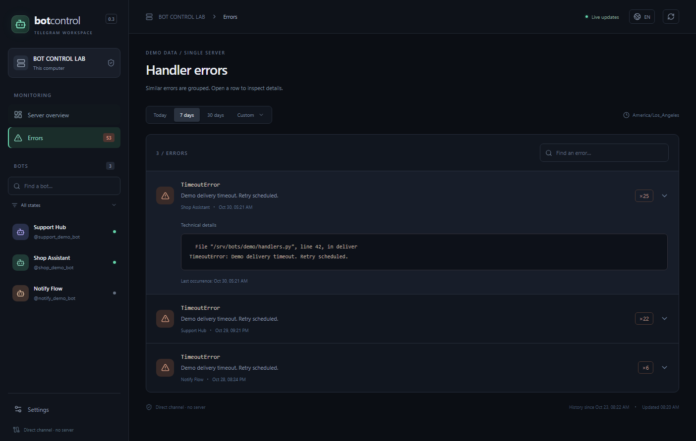
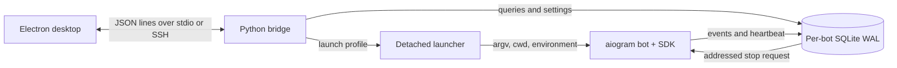

<div align="center">
  
  <h1>Telegram Bot Control</h1>
  <p>Desktop monitoring and process control for aiogram bots.</p>
  <p>Python · aiogram · Electron · React · TypeScript · SQLite</p>
  <p><a href="README.ru.md">Русская инструкция</a> · <a href="docs/process-control.md">Launch profiles</a> · <a href="docs/case-study.md">Engineering notes</a> · <a href="docs/releasing.md">Release guide</a></p>
</div>

**v0.5.1 · Preview · MIT**

Startup failures now show retained command stdout/stderr, including errors before
SDK initialization, with secret redaction and bounded output history.

New in 0.5.0: existing logging/Loguru streams, per-process CPU/RSS history, bounded
on-failure restarts and a guided existing-project connector. Available in both
desktop and web modes. [Diagnostics](docs/diagnostics.ru.md) · [Project wizard](docs/project-wizard.ru.md).

One owner, one server, many bots. Connect a small Python SDK to existing aiogram
applications, inspect activity and exceptions, and control their processes from a
dark desktop interface. Local transport uses SQLite WAL and standard input/output.
Remote Linux access uses the same bridge over SSH.

An optional authenticated web dashboard serves the same interface on a chosen port,
including headless hosts and Termux. It is disabled by default. Run
`tgbots web --port 8765 --data-dir /srv/bot-control/data`, or enable it under desktop
Settings → Web dashboard. The terminal/settings show a separate browser access key.
[Web/Termux guide](docs/web-panel.ru.md).

[Measured distribution size and packaging changes](docs/size-report.md).


_All screenshots use synthetic demo data and anonymous server labels._

## Install a release

Download desktop installers or the portable Windows ZIP from
[GitHub Releases](https://github.com/olegoleg1111121/telegram-bot-control/releases).
The Python wheel includes the web dashboard and can be installed without Node.js:

```sh
python -m pip install "telegram-bot-control[aiogram] @ https://github.com/olegoleg1111121/telegram-bot-control/releases/download/v0.5.1/telegram_bot_control-0.5.1-py3-none-any.whl"
```

A PyPI Trusted Publishing workflow is included. Once the PyPI project is published,
the equivalent command is `python -m pip install "telegram-bot-control[aiogram]"`.
[PyPI setup and publication](docs/pypi.ru.md).

## What it does

- Registers bots automatically and keeps their history across restarts.
- Shows heartbeat state separately from user activity.
- Counts messages, commands, callbacks and distinct users over a selected range.
- Groups handler exceptions and expands sanitized technical details.
- Starts, gracefully stops and restarts bots with their configured launch profile.
- Preserves arguments, working directory, preparation steps and environment-file paths.
- Checks process identity using PID and creation time before termination.
- Keeps collecting while the desktop window is closed.
- Supports Russian and English, time zones and configurable retention.
- Includes a first-run guide, close-to-tray behavior and Windows installation shortcuts.
- Optional browser access, responsive phone layout and locally bundled Inter fonts.

[First-run walkthrough (Russian)](docs/getting-started.ru.md). Reopen the in-app guide
from the sidebar or system tray. Closing the window hides it; use the tray menu to quit.

<details>
<summary>First-run guide</summary>



</details>

## Try it locally

Requirements: **Python 3.11+**, **Node.js 24**, and **pnpm 11.25.0**.
Run these commands from a source checkout or extracted source archive:

```powershell
python -m venv .venv
.\.venv\Scripts\python.exe -m pip install -e '.[dev]'
pnpm install --dir desktop --frozen-lockfile
pnpm --dir desktop run build
```

For Linux, use `.venv/bin/python` and `.venv/bin/tgbots`.
Install pnpm with `npm install --global pnpm@11.25.0` if needed.

Start an explicit offline analytics demo in one terminal:

```powershell
.\.venv\Scripts\tgbots.exe demo --bots 3 --data-dir .bot-control
```

Open the desktop from another terminal in the same folder:

```powershell
.\.venv\Scripts\tgbots.exe open --data-dir .bot-control
```

The demo uses real aiogram dispatchers with a network-free session. It generates
messages, commands, button events and a controlled exception. No Telegram account
or bot token is required.

For the independent Start/Stop/Restart walkthrough, use the complex fixture:

```powershell
.\.venv\Scripts\python.exe scripts/control_fixture.py --data-dir .bot-control/workflow --project-dir '.test-data/Workflow Bot'
.\.venv\Scripts\tgbots.exe open --data-dir .bot-control/workflow
```

Select the bot card and press **Start**. This fixture includes nested routers,
FSM, a preparation command, arguments with spaces and a separate environment file.

## Connect an existing bot

Install this Python package into the bot's environment, then add:

```python
from telegram_bot_control import start

monitor = start(
    bot=bot,
    dispatcher=dp,
    data_dir=r"C:\BotControl\data",
    actions={"catalog:open": "catalog.open"},
)
dp.update.outer_middleware(monitor.middleware())

await dp.start_polling(bot)
```

All bots and the desktop must use the same local data directory. On Linux, choose
an absolute path such as `/srv/bot-control`. The import performs no registration
or network request; recording begins during aiogram startup.

For webhook or custom runtimes, connect the dispatcher lifecycle and provide a
`shutdown` callback. See the [Russian integration guide](README.ru.md) and
[process-control reference](docs/process-control.md).

## Process control and complex launches

The SDK records the actual Python arguments and working directory. Configure an
explicit profile for wrappers, preparation or tools such as PowerShell:

```json
{
  "command": ["/opt/bots/.venv/bin/python", "-u", "-m", "shop_bot", "--config", "config/prod config.json"],
  "cwd": "/opt/bots/shop",
  "pre_start": [["/opt/bots/.venv/bin/python", "prepare.py"]],
  "env_file": "/opt/bots/shop/.env",
  "environment": {"BOT_MODE": "production"},
  "required_env": ["BOT_TOKEN"]
}
```

Arguments are passed with `shell=False`. Secrets belong in an environment file or
an environment-variable reference. A failed preflight keeps an existing bot running.
Graceful shutdown is attempted first; forced termination requires a separate action.

<details>
<summary>Process controls and grouped exceptions</summary>




</details>

## Architecture



The reader is a child process of the desktop. Each bot owns its recorder and file,
so collection continues independently of the window. SSH runs the reader on the
server; SQLite is always accessed on that machine's local disk.

[Design decisions](docs/case-study.md) · [Implementation overview](docs/architecture.md)

## Verification

```powershell
.\.venv\Scripts\python.exe -m pytest -q
pnpm --dir desktop run test
pnpm --dir desktop run format:check
pnpm --dir desktop run build
.\.venv\Scripts\python.exe scripts/release_check.py
```

The suite covers genuine aiogram handling, distinct-user aggregation, deduplication,
retention, backups, process identity, concurrent starts, complex launch profiles,
PowerShell, failed preparation and graceful/forced shutdown. Electron smoke tests
press the real controls and inspect the resulting state.

[Recorded validation and remaining platform checks](docs/validation.md).
Windows was exercised locally. GitHub Actions are configured for Windows and Linux;
hosted CI results will be available after this repository is published.

## Release and installation

A release contains the Python wheel, Python source distribution, full source archive,
Windows installer, portable Windows folder archive and SHA256 checksums. The tag
workflow also builds a Linux AppImage. Python is installed separately and selected
in desktop connection settings.

The desktop binaries are unsigned preview builds. Review the release notes and
verify checksums before use. Local preparation and later GitHub publication are
separate steps: [release guide](docs/releasing.md).

## Scope

- One owner and one server, with separate OS processes for independently controlled bots.
- No Docker or multi-user account/role system. Web access is owner-only.
- No systemd, Windows-service or external-supervisor adapter yet.
- Raw updates, message bodies and full callback payloads are excluded from telemetry.
- User identifiers are pseudonymized per bot for distinct counts.
- Abrupt shutdown or storage failure can lose queued telemetry; loss counters are exposed.
- Retention defaults: statistics 365 days, errors 30 days, diagnostics 7 days.

[Security model](SECURITY.md) · [Contributing](CONTRIBUTING.md) · [Changelog](CHANGELOG.md)

## Author and license

Created and maintained by the repository owner. Original project code and assets
are available under the [MIT license](LICENSE). Third-party components retain their
respective licenses; see [notices](THIRD_PARTY_NOTICES.md).
